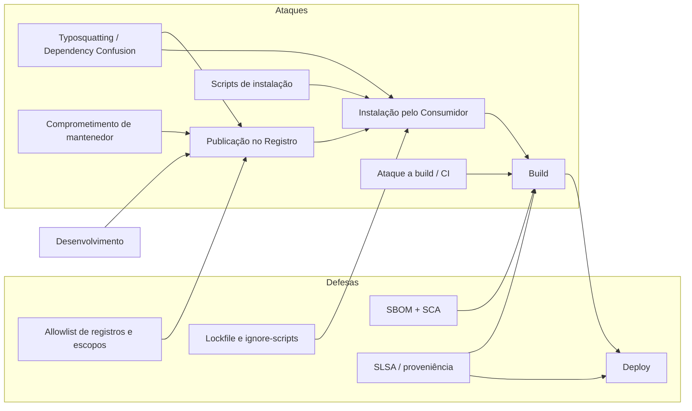
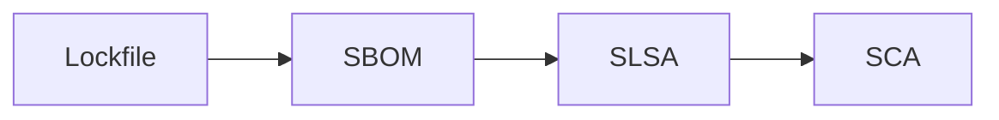

# Segurança de Pacotes e Cadeia de Suprimentos de Software — Guia Defensivo


Este guia cobre a anatomia de pacotes, gerenciadores de dependências, vetores de ataque à cadeia de suprimentos e controles defensivos para desenvolvimento, DevSecOps, Application Security e estudo. O foco é prático: inventariar componentes, controlar versões, verificar a origem dos artefatos e reduzir a execução implícita de código durante instalação e build.

As principais práticas usam SBOM (Software Bill of Materials), SLSA (Supply-chain Levels for Software Artifacts) e SCA (Software Composition Analysis) para transformar componentes em inventário, proveniência e decisão contínua de risco.

## Respostas rápidas

| Preciso de... | Onde começar |
|---|---|
| Entender termos como SBOM, SLSA e SCA | [Glossário](docs/glossario.md) |
| Conhecer como pacotes e registros funcionam | [Fundamentos](docs/fundamentos/o-que-e-um-pacote.md) |
| Identificar typosquatting e pacote malicioso | [Vetores de ataque](docs/vetores-de-ataque/typosquatting.md) |
| Criar SBOM, fixar versões e verificar proveniência | [Defesas](docs/defesas/lockfiles-e-pinning.md) |
| Aplicar um checklist em projeto ou pipeline | [Checklist prático](docs/checklists/checklist-pratico.md) |

## Ciclo de vida de um pacote



## Defesa em camadas



## Quick Start

1. Leia o [glossário](docs/glossario.md) para estabelecer uma linguagem comum.
2. Escolha o [vetor de ataque](docs/vetores-de-ataque/typosquatting.md) relevante ao seu ecossistema e revise os sinais de detecção.
3. Adote o [pinning e os lockfiles](docs/defesas/lockfiles-e-pinning.md), depois amplie a cobertura com SBOM e análise de composição.

## Estrutura do repositório

```text
.
├── README.md
├── LICENSE
├── SECURITY.md
├── docs/
│   ├── glossario.md
│   ├── fundamentos/
│   │   ├── o-que-e-um-pacote.md
│   │   ├── gerenciadores-de-pacotes.md
│   │   └── registro-e-distribuicao.md
│   ├── vetores-de-ataque/
│   │   ├── typosquatting.md
│   │   ├── dependency-confusion.md
│   │   ├── pacotes-maliciosos.md
│   │   ├── comprometimento-de-mantenedor.md
│   │   └── ataques-a-build-e-ci.md
│   ├── defesas/
│   │   ├── lockfiles-e-pinning.md
│   │   ├── sbom-e-inventario.md
│   │   ├── slsa-e-proveniencia.md
│   │   ├── sca-e-analise-de-composicao.md
│   │   ├── registro-privado-e-proxies.md
│   │   └── hardening-por-ecossistema.md
│   ├── ferramentas/
│   │   └── ferramentas-essenciais.md
│   └── checklists/
│       └── checklist-pratico.md
└── .github/
    └── copilot-instructions.md
```

Consulte a [política de segurança](SECURITY.md) e os termos da [licença MIT](LICENSE).
