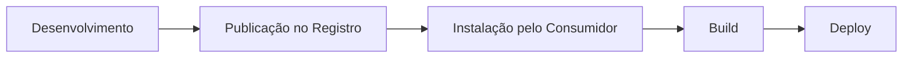

# Guia de Segurança de Pacotes — Plano de Implementação

> **For agentic workers:** REQUIRED SUB-SKILL: Use superpowers:subagent-driven-development (recommended) or superpowers:executing-plans to implement this plan task-by-task. Steps use checkbox (`- [ ]`) syntax for tracking.

**Goal:** Gerar um repositório GitHub completo de documentação em pt-BR sobre segurança de pacotes e cadeia de suprimentos, com 18 arquivos Markdown seguindo a estrutura aprovada, diagramas Mermaid, dados fonteados e commits semânticos.

**Architecture:** Repositório git independente em `/home/exped/Projetos/repositório_pacotes`. Estrutura "Minimal Root, máxima navegabilidade": raiz com README/LICENSE/SECURITY/.gitignore, `docs/` com subpastas por tema (glossario, fundamentos, vetores-de-ataque, defesas, ferramentas, checklists) e `.github/copilot-instructions.md`. Cada arquivo segue seções fixas para leitura paralela. Um commit semântico por etapa, na ordem do item 7.

**Tech Stack:** Markdown, Mermaid (renderizado pelo GitHub), Shields.io badges, git. Sem build, sem dependências.

**Spec:** `docs/superpowers/specs/2026-11-23-guia-seguranca-pacotes-design.md`

## Global Constraints

- Idioma: pt-BR; tom técnico, direto, orientado à defesa.
- **Zero código malicioso ou PoC de ataque** — apenas descrição conceitual e defesa (spec Seção 6).
- **Nenhum dado inventado**: número exige fonte (instituição) + ano. Sem fonte verificável → formulação qualitativa ("amplamente documentado", "relatórios recentes").
- Siglas expandidas na primeira menção de cada arquivo.
- Links entre arquivos sempre relativos (ex.: `../fundamentos/o-que-e-um-pacote.md`).
- Nome do repo: `guia_seguranca_pacotes_supply_chain`. Licença: MIT.
- Ordem de commits (spec Seção 7): README → glossário → fundamentos → vetores → defesas → ferramentas → checklists.
- Mensagens de commit semânticas em inglês (`docs:`, `chore:`), corpo opcional em pt-BR.

## Review Focus

Falhas que um revisor humano deve checar e que nenhum passo verifica sozinho:

1. **Números sem fonte** — todo `%` ou contagem citada deve ter instituição + ano na mesma frase. Teste (Task 9, Passo 2): `grep -rnE '[0-9]+ ?(%|mil|milhões|bilhões)' docs/ | grep -viE 'semver|nível|versão|SHA-?256|L[123]|página|linha'` — cada linha restante precisa de fonte.
2. **Links relativos quebrados** — Teste (Task 9, Passo 1): script bash que extrai `](...md` de cada arquivo e confere existência do alvo.
3. **Mermaid inválido** — Teste (Task 2, Passo 3 e Task 9, Passo 3): checar balanceamento de `graph`/`flowchart`/`subgraph` e de aspas; se `mmdc` estiver instalado, `mmdc -i <arquivo>`; caso contrário, inspeção estrutural documentada no passo.
4. **Sigla não expandida** — Teste (Task 9, Passo 4): para as siglas da spec (SBOM, SLSA, SCA, SRI, CPE, OSV, CycloneDX, SPDX), grep que a primeira ocorrência em cada arquivo está seguida de expansão entre parênteses.
5. **Conteúdo ofensivo acidental** — Teste (Task 9, Passo 5): grep proibindo padrões de payload (`curl | bash`, `--extra-index-url http` com URL fictícia de exfiltração, blocos com `import requests; ... socket`), garantindo que só descrições conceituais sobrevivam.

---

### Task 1: Scaffolding do repositório

**Files:**
- Create: `LICENSE`, `.gitignore`

**Interfaces:**
- Consumes: nada.
- Produces: repo git inicializado; arquivos base para os commits seguintes.

- [ ] **Step 1: Inicializar repo e criar `LICENSE` (MIT, copyright 2026, autor = nome do usuário no git)**

```bash
git init
git config user.name  # usar o valor já configurado na máquina
```

`LICENSE`: texto MIT padrão com `Copyright (c) 2026 <nome do git>`.

- [ ] **Step 2: Criar `.gitignore`**

Conteúdo: `.DS_Store`, `node_modules/`, `__pycache__/`, `.venv/`, `*.log`, `.idea/`, `.vscode/`, e o diretório `.superpowers/` (se existir).

- [ ] **Step 3: Commit**

```bash
git add LICENSE .gitignore
git commit -m "chore: initialize repository with MIT license and gitignore"
```

---

### Task 2: README.md — painel de entrada

**Files:**
- Create: `README.md`

**Interfaces:**
- Consumes: estrutura final de `docs/` (definida no spec Seção 3; os arquivos ainda não existem — links do índice são proféticos e válidos no fim).
- Produces: tabela de respostas rápidas e Mermaid do ciclo de vida referenciados pelo plano inteiro.

- [ ] **Step 1: Escrever `README.md` com:**

- H1: `Segurança de Pacotes e Cadeia de Suprimentos de Software — Guia Defensivo`.
- Parágrafo de escopo (pt-BR, ~4 linhas: o que o guia cobre e para quem).
- Badges Shields.io em linha: licença MIT (`https://img.shields.io/badge/licença-MIT-blue`), última revisão `2026-11`, OpenSSF Scorecard (`https://api.scorecard.dev/projects/github.com/guia_seguranca_pacotes_supply_chain/badge`).
- Seção **"Respostas rápidas"** com a tabela de 5 linhas exatas da spec (Seção 4.1), coluna 2 = caminhos relativos.
- Seção **"Ciclo de vida de um pacote"** com diagrama Mermaid `flowchart LR`:



Com `subgraph Ataques` ligando nós de ataque aos estágios: typosquatting/dependency confusion → B e C; scripts de instalação → C; comprometimento de mantenedor → B; ataque a build/CI → D. E `subgraph Defesas` ligando: allowlist de registros e escopos → B; lockfile e ignore-scripts → C; SBOM + SCA → D; SLSA/proveniência → D e E.

- Seção **"Defesa em camadas"** com segundo Mermaid `flowchart LR`: `Lockfile → SBOM → SLSA → SCA` (spec Seção 5).
- Seção **"Quick Start"** em 3 passos: 1) `docs/glossario.md` → 2) `docs/vetores-de-ataque/typosquatting.md` (e irmãos) → 3) `docs/defesas/lockfiles-e-pinning.md` (e irmãos).
- Seção **"Estrutura do repositório"** com a árvore da spec Seção 3.
- Rodapé: link para `SECURITY.md` e `LICENSE`.

- [ ] **Step 2: Validar links internos do README**

Run: `grep -oE '\]\([^)]*\.md[^)]*\)' README.md | sed 's/](\(.*\))/\1/' | while read p; do test -e "$p" || echo "QUEBRADO: $p"; done`
Expected: os alvos ainda não existem (serão criados nas Tasks 3–8); anotar a lista e re-rodar no Task 9.

- [ ] **Step 3: Validar Mermaid (structural)**

Run: `grep -c 'subgraph' README.md` e checar que todo `subgraph X` tem `end` correspondente (`grep -c '^end' README.md` ≥ número de subgraphs).
Expected: contagens batem; se `mmdc` existir (`command -v mmdc`), renderizar os dois diagramas sem erro.

- [ ] **Step 4: Commit**

```bash
git add README.md
git commit -m "docs: add entry dashboard with quick answers and lifecycle diagram"
```

---

### Task 3: `docs/glossario.md`

**Files:**
- Create: `docs/glossario.md`

**Interfaces:**
- Consumes: nada (é o primeiro conteúdo).
- Produce: definições usadas por todos os demais arquivos — nomes exatos das entradas abaixo.

- [ ] **Step 1: Escrever `docs/glossario.md`**

Tabela de duas colunas (Termo | Definição) com, no mínimo, as 21 entradas da spec Seção 4.2: Pacote, Dependência direta, Dependência transitiva, Lockfile, Versionamento Semântico (SemVer), Registry, SBOM, CycloneDX, SPDX, SLSA, Proveniência, SCA, SRI, CPE, OSV, Typosquatting, Dependency Confusion, Supply Chain Attack, Build Provenance, plus (permitido) Artefato e Attestation. Cada sigla expandida na própria entrada (ex.: `**SBOM** (Software Bill of Materials, "lista de materiais de software")`). Definições de 1–3 frases, foco no porquê de segurança. Links relativos: `../defesas/sbom-e-inventario.md`, etc.

- [ ] **Step 2: Checagem de cobertura**

Run: `for t in "Pacote" "dependência transitiva" "Lockfile" "SemVer" "Registry" "SBOM" "CycloneDX" "SPDX" "SLSA" "Proveniência" "SCA" "SRI" "CPE" "OSV" "Typosquatting" "Dependency Confusion" "Supply Chain" "Build Provenance"; do grep -qi "$t" docs/glossario.md || echo "FALTA: $t"; done`
Expected: sem saída "FALTA".

- [ ] **Step 3: Commit**

```bash
git add docs/glossario.md
git commit -m "docs: add glossary of supply chain security terms"
```

---

### Task 4: `docs/fundamentos/` (3 arquivos)

**Files:**
- Create: `docs/fundamentos/o-que-e-um-pacote.md`
- Create: `docs/fundamentos/gerenciadores-de-pacotes.md`
- Create: `docs/fundamentos/registro-e-distribuicao.md`

**Interfaces:**
- Consumes: glossário (Task 3) para terminologia.
- Produces: páginas base linkadas pelo README e pelos vetores de ataque.

- [ ] **Step 1: Escrever `o-que-e-um-pacote.md`**

Seções: *O que é* / *Anatomia* (metadados, arquivos, scripts de instalação, dependências — com árvore de exemplo de um tarball npm genérico, sem código ofensivo) / *Versionamento semântico* (MAJOR.MINOR.PATCH, tabela de regras) / *Dependências diretas vs transitivas* (por que transitivas são risco negligenciado — formulación qualitativa citando "estudos de SCA apontam a maioria das vulnerabilidades em dependências transitivas" só com fonte, senão qualitativo) / *Por que isso importa para segurança*.

- [ ] **Step 2: Escrever `gerenciadores-de-pacotes.md`**

Tabela comparativa (npm, PyPI/pip, Maven, Go Modules, NuGet, Cargo) com colunas: Gerenciador | Registro padrão | Arquivo de lock | Resolução de dependências | Risco específico. Depois, subseção por gerenciador com 3–6 linhas cada, priorizando o risco (ex.: npm e scripts pós-instalação; PyPI e index-url; Go e proxy/sumdb; Maven e plugins de build).

- [ ] **Step 3: Escrever `registro-e-distribuicao.md`**

Seções: *Como um pacote é publicado* (fluxo: build → upload → metadados) / *Assinatura e verificação* (a maioria dos ecossistemas não exige assinatura — qualitativo; menção a Sigstore/cosign) / *Público vs privado* (quando usar cada um, apontando para `../defesas/registro-privado-e-proxies.md`) / *Papel do mirror/proxy*.

- [ ] **Step 4: Validar links dos 3 arquivos**

Run: `for f in docs/fundamentos/*.md; do grep -oE '\]\([^)#]*\.md' "$f" | sed 's/](//' | while read p; do t="$(dirname $f)/$p"; test -e "$t" || echo "QUEBRADO em $f: $p"; done; done`
Expected: sem saída (alguns alvos de `../defesas/` ainda não existem — anotar e re-validar no Task 9).

- [ ] **Step 5: Commit**

```bash
git add docs/fundamentos/
git commit -m "docs: add fundamentals on package anatomy, managers, and distribution"
```

---

### Task 5: `docs/vetores-de-ataque/` (5 arquivos)

**Files:**
- Create: `docs/vetores-de-ataque/typosquatting.md`
- Create: `docs/vetores-de-ataque/dependency-confusion.md`
- Create: `docs/vetores-de-ataque/pacotes-maliciosos.md`
- Create: `docs/vetores-de-ataque/comprometimento-de-mantenedor.md`
- Create: `docs/vetores-de-ataque/ataques-a-build-e-ci.md`

**Interfaces:**
- Consumes: fundamentos (Task 4); defesas linkadas por nome (`../defesas/lockfiles-e-pinning.md`, `../defesas/registro-privado-e-proxies.md`, `../defesas/hardening-por-ecossistema.md`) — criadas na Task 6.
- Produces: vocabulário de ataque referenciado pelo README e checklists.

- [ ] **Step 1: Definir o template comum (aplicado aos 5 arquivos)**

Cada arquivo tem exatamente estas seções H2, nesta ordem:
1. `## O que é` (2–4 frases, sigla expandida na primeira menção)
2. `## Como funciona` (passos numerados conceituais, **sem comandos de exploração**)
3. `## Exemplo real` (caso público documentado com fonte e ano; se a busca web falhar → seção `## Exemplos na imprensa` com formulación qualitativa: "incidentes públicos recorrentes em npm e PyPI, conforme relatórios do Sonatype e da ENISA")
4. `## Como detectar` (sinais, ferramentas — ex.: OSV-Scanner, allowlist de nomes)
5. `## Como mitigar` (bullets acionáveis,链接 para defesas)

- [ ] **Step 2: Pesquisar dados atualizados**

Run: `websearch` para: "Sonatype State of the Software Supply Chain 2025 malicious packages", "ENISA threat landscape 2025 supply chain", "typosquatting npm PyPI 2025 incident". Guardar cada número com fonte+ano. Se busca indisponível ou número não confirmado → usar formulación qualitativa (Global Constraint).

- [ ] **Step 3: Escrever os 5 arquivos seguindo o template**

Pontos que a spec fixa e devem aparecer:
- `typosquatting.md`: exemplo `requsts` vs `requests`; escalada em npm/PyPI.
- `dependency-confusion.md`: mecanismo do pacote público "substituir" o interno; defesa = escopos `@minha-org/`, registro privado, **evitar `--extra-index-url` no PyPI**; nota sobre como resolvedores priorizam o maior número de versão.
- `pacotes-maliciosos.md`: scripts `preinstall`/`postinstall` executam código na instalação; mitigação `ignore-scripts`, proxy de pacotes.
- `comprometimento-de-mantenedor.md`: sequestro de conta/Token 2FA de mantenedor; ataques a npm e PyPI; mitigação 2FA + revogação de tokens + escopos.
- `ataques-a-build-e-ci.md`: injeção em pipeline, artefatos não verificados, runners não confiáveis; mitigação SLSA, segredos com escopo mínimo, ambientes efêmeros.

- [ ] **Step 4: Checagem de template e de conteúdo proibido**

Run: `for f in docs/vetores-de-ataque/*.md; do for s in "## O que é" "## Como funciona" "## Como detectar" "## Como mitigar"; do grep -qF "$s" "$f" || echo "FALTA $s em $f"; done; done`
Run: `grep -rnE 'curl .*\| *(ba)?sh|pip install --extra-index-url http|python -c .*(socket|subprocess)' docs/vetores-de-ataque/ || echo OK`
Expected: primeira sem saída; segunda retorna `OK` (nenhum comando ofensivo).

- [ ] **Step 5: Commit**

```bash
git add docs/vetores-de-ataque/
git commit -m "docs: add attack vectors (typosquatting, confusion, malicious packages, maintainer, CI)"
```

---

### Task 6: `docs/defesas/` (6 arquivos)

**Files:**
- Create: `docs/defesas/lockfiles-e-pinning.md`
- Create: `docs/defesas/sbom-e-inventario.md`
- Create: `docs/defesas/slsa-e-proveniencia.md`
- Create: `docs/defesas/sca-e-analise-de-composicao.md`
- Create: `docs/defesas/registro-privado-e-proxies.md`
- Create: `docs/defesas/hardening-por-ecossistema.md`

**Interfaces:**
- Consumes: vetores (Task 5) para ligar defesa→ataque; ferramentas nomeadas na Task 7 (`syft`, `cosign`, `OSV-Scanner`).
- Produces: alvos dos links do README, dos vetores e do checklist (Task 8).

- [ ] **Step 1: Escrever `lockfiles-e-pinning.md`**

Por que commitar lockfiles; tabela lockfile por ecossistema (package-lock.json / poetry.lock / Cargo.lock / go.sum / packages.lock.json / pom.xml com ranges); pinning por hash SHA vs tag mutável; processo de change management para atualizar dependências; exemplo de `go.mod` com versão fixada e nota sobre `go.sum`.

- [ ] **Step 2: Escrever `sbom-e-inventario.md`**

Definição de SBOM com a sigla expandida; tabela **CycloneDX vs SPDX** (colunas: mantenedor, foco, formatos, adoção, bom para); como gerar no build (ex.: `syft dir:. -o cyclonedx-json > sbom.json`); usos: conformidade, resposta a incidentes, SCA alimentando do SBOM; link para ferramentas.

- [ ] **Step 3: Escrever `slsa-e-proveniencia.md`**

Definição de SLSA expandida na primeira menção; tabela **L1 vs L2 vs L3** (colunas: exigência principal, valor de segurança, esforço); nota de que L3 é meta comum para builds automatizados (qualitativo, sem citar percentuais); proveniência assinada e verificação com `cosign verify-attestation`; ligação com `ataques-a-build-e-ci.md`.

- [ ] **Step 4: Escrever `sca-e-analise-de-composicao.md`**

Definição de SCA; como funciona (match de dependências × base de vulnerabilidades: OSV/NVD/CVE); tabela de ferramentas (OWASP Dependency-Check, Snyk, Dependabot, Renovate, OSV-Scanner) com tipo/licença/integração; onde entra no pipeline (gate de CI); limitações (falsos positivos, vulnerabilidade sem CVE).

- [ ] **Step 5: Escrever `registro-privado-e-proxies.md`**

Quando usar registry privado (Verdaccio, Artifactory, Nexus, PyPI privado); proxy/cache como ponto de auditoria; allowlist de registries; escopos/namespaces; ligação com dependency confusion (`../vetores-de-ataque/dependency-confusion.md`).

- [ ] **Step 6: Escrever `hardening-por-ecossistema.md` (o mais copiável)**

Uma H2 por ecossistema com blocos `bash` exatos:

```bash
# npm
npm config set ignore-scripts true
npm config set allow-git false
npm config set audit true
# instalação com idade mínima de release (npm >= 11): npm config set min-release-age 86400000
```

```bash
# PyPI — usar --index-url, NUNCA --extra-index-url
pip install --index-url https://pypi.internal.example/simple pacote-interno
# pip: pinhash em requirements (pip-compile) e --require-hashes
```

```bash
# Go
go mod tidy && go mod verify
# exigir proxy e sumdb no go.env do módulo
# Cargo: cargo update --precise <versão> ; Cargo.lock commitado
# Maven: maven-enforcer-plugin requireReleaseDeps + dependências fixadas
# NuGet: packages.lock.json com RestorePackagesWithLockFile=true
```

Notas de segurança explicando cada configuração em 1 linha.

- [ ] **Step 7: Validação**

Run: `for f in docs/defesas/*.md; do grep -qE '^## ' "$f" || echo "SEM H2: $f"; done` e o mesmo script de links da Task 4 apontando para `docs/`.
Expected: sem problemas estruturais.

- [ ] **Step 8: Commit**

```bash
git add docs/defesas/
git commit -m "docs: add defenses (lockfiles, SBOM, SLSA, SCA, private registry, hardening)"
```

---

### Task 7: `docs/ferramentas/ferramentas-essenciais.md`

**Files:**
- Create: `docs/ferramentas/ferramentas-essenciais.md`

**Interfaces:**
- Consumes: nomes citados nas defesas (Task 6).
- Produces: tabela usada pelo checklist.

- [ ] **Step 1: Escrever o arquivo**

Tabela principal com colunas: Ferramenta | Propósito | Ecossistemas | Tipo (grátis/open source/comercial) | Comando de exemplo. Linhas: **syft** (SBOM CycloneDX/SPDX), **cosign / Sigstore** (assinatura e verificação), **OSV-Scanner** (vulnerabilidades), **OpenSSF Scorecard** (postura de projetos), **Dependabot / Renovate** (atualização automatizada), **OWASP Dependency-Check** (SCA). Subseção "Combinação recomendada" com o fluxo: `syft → OSV-Scanner → cosign → Scorecard`. Links para as defesas correspondentes.

- [ ] **Step 2: Checagem**

Run: `for t in syft cosign OSV-Scanner Scorecard Dependabot Renovate "Dependency-Check"; do grep -q "$t" docs/ferramentas/ferramentas-essenciais.md || echo "FALTA: $t"; done`
Expected: sem saída.

- [ ] **Step 3: Commit**

```bash
git add docs/ferramentas/
git commit -m "docs: add essential tooling table (syft, cosign, OSV-Scanner, Scorecard)"
```

---

### Task 8: `docs/checklists/checklist-pratico.md` + `SECURITY.md` + `.github/copilot-instructions.md`

**Files:**
- Create: `docs/checklists/checklist-pratico.md`
- Create: `SECURITY.md`
- Create: `.github/copilot-instructions.md`

**Interfaces:**
- Consumes: todos os docs anteriores (linka cada item à defesa correspondente).
- Produces: entrega final navegável.

- [ ] **Step 1: Escrever `checklist-pratico.md`**

Duas seções H2: `## Desenvolvedor` e `## Engenheiro de segurança`, cada uma com checkboxes `[ ]` da spec Seção 4.7 (os 8 itens mínimos, distribuídos) **mais** 3–5 itens derivados dos docs (ex.: revisar changelog ao atualizar; rodar `cosign verify`; checar `min-release-age`; proibir `--extra-index-url` em CI). Cada item com link relativo para a página de defesa que o justifica.

- [ ] **Step 2: Escrever `SECURITY.md`**

Conteúdo: (1) canal de contato responsável (placeholder `security@example.com` — nota para o autor substituir); (2) declaração de caráter **puramente educacional**: o repositório contém apenas documentação conceitual, nenhum código ofensivo ou PoC de ataque; (3) aviso de que vulnerabilidades em documentação (dados desatualizados, link quebrado) devem ser reportadas via GitHub Security Advisory.

- [ ] **Step 3: Escrever `.github/copilot-instructions.md`**

Curto (~15 linhas): repositório é documentação em pt-BR; nunca introduzir código ofensivo/PoC; manter siglas expandidas na primeira menção; links relativos; dados exigem fonte+ano; seguir o template de seções dos vetores/defesas; commits semânticos.

- [ ] **Step 4: Commit**

```bash
git add docs/checklists/ SECURITY.md .github/
git commit -m "docs: add actionable checklists, security policy, and assistant instructions"
```

---

### Task 9: Validação final do repositório

**Files:**
- Modify: qualquer arquivo com defeito encontrado
- Create: nenhum

**Interfaces:**
- Consumes: todos os arquivos das Tasks 1–8.
- Produces: repo íntegro, pronto para push.

- [ ] **Step 1: Validar todos os links relativos**

Run:
```bash
err=0
for f in $(find . -name '*.md' -not -path './docs/superpowers/*'); do
  grep -oE '\]\([^)#]*\.md' "$f" | sed 's/](//' | while read p; do
    t="$(dirname $f)/$p"
    [ -e "$t" ] || { echo "QUEBRADO em $f: $p"; err=1; }
  done
done
[ $err -eq 0 ] && echo "LINKS OK"
```
Expected: `LINKS OK`. Corrigir cada quebra apontada.

- [ ] **Step 2: Validar dados (Review Focus 1)**

Run: `grep -rnE '[0-9]+ ?(%|mil |milh(õ|o)es|bilh)' README.md docs/ --include='*.md'`
Expected: cada linha contém fonte (ENISA|Sonatype|OpenSSF|OWASP|CSA|Snyk|Google|GitHub|NVD|CVE) + ano, ou é removida/reescrita em qualitativo.

- [ ] **Step 3: Validar Mermaid**

Run: `command -v mmdc && for f in $(grep -rl '```mermaid' README.md docs/); do echo $f; done` — se `mmdc` existir, renderizar; senão, checar manualmente balanceamento `graph|flowchart`/`subgraph`/`end` em cada bloco.
Expected: todos os diagramas parseiam (ou verificação estrutural registrada).

- [ ] **Step 4: Validar siglas expandidas**

Run: `grep -rn 'SBOM\|SLSA\|SCA\b' docs/ --include='*.md' | head -20` e conferir manualmente que a primeira ocorrência de cada sigla em cada arquivo tem a expansão em parênteses.
Expected: sem sigla órfã na primeira menção.

- [ ] **Step 5: Varredura final de conteúdo ofensivo**

Run: `grep -rnE 'curl .*\| *(ba)?sh|wget .*\| *(ba)?sh|nc -e|msfconsole|exploit' README.md docs/ .github/ || echo LIMPO`
Expected: `LIMPO` (qualquer hit é revisado e removido, a menos que seja menção conceitual explícita permitida pela spec).

- [ ] **Step 6: Commit final e resumo**

```bash
git add -A
git commit -m "docs: final validation pass (links, data sources, mermaid, acronyms)"
git log --oneline
```

Expected: 8–9 commits semânticos na ordem definida.

---

## Cobertura da spec (self-review)

| Spec | Task |
|---|---|
| Seção 3 estrutura (18 arquivos) | 1–8 |
| 4.1 README (badges, tabela, Mermaid ×2, Quick Start) | 2 |
| 4.2 glossário (21 termos) | 3 |
| 4.3 fundamentos (3) | 4 |
| 4.4 vetores (5, template fixo) | 5 |
| 4.5 defesas (6, configs exatas) | 6 |
| 4.6 ferramentas | 7 |
| 4.7 checklist | 8 |
| 4.8 SECURITY.md | 8 |
| Seção 5 boas práticas | distribuído em 2, 5, 6, 9 |
| Seção 6 restrições | Global Constraints + Task 5 Step 4 + Task 9 Step 5 |
| Seção 7 ordem de commits | Tasks 2–8 |
